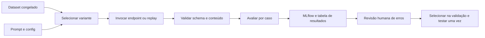

# 04 — Bancada de prompts e experimentos com LLMs

**Estado demonstrado:** Planejado · standby. Evidências de 28/10/2026 quando aplicável.

Este documento preserva requisitos e design do estudo. Etapas futuras, quantidades planejadas e critérios de aceite não comprovam execução. Consulte o estudo de caso para escopo, resultados e limites atuais.

**Estado:** planejado. **Competência:** desenhar experimentos, comparar configurações e justificar uma escolha. **Dependências:** endpoint permitido ou modo replay explícito; corpus do projeto 03 para tarefas RAG. Padrões gerais se aplicam.

## Objetivo e requisitos

Medir se um prompt, modelo ou fluxo resolve melhor a tarefa, com qualidade, latência e consumo rastreáveis.

| ID | Requisito | Aceite futuro |
| --- | --- | --- |
| RF01 | Congelar um dataset com splits | IDs, gabaritos, grupos de intenção e hash preservados |
| RF02 | Versionar prompts completos | Texto, variáveis, exemplos e versão recuperáveis |
| RF03 | Executar configurações comparáveis | Mesmos casos, critérios e orçamento por comparação |
| RF04 | Validar saídas sem depender só de outro LLM | Schema e métricas determinísticas presentes |
| RF05 | Calibrar julgamentos subjetivos | Rubrica e amostra anotada por pessoa |
| RF06 | Registrar erros e execuções incompletas | Falhas entram no relatório e no denominador |
| RNF01 | Evitar overfitting no teste | Teste final consultado após fechar a configuração |
| RNF02 | Limitar custo experimental | Quantidade máxima de chamadas e timeout definidos |

Tarefas iniciais: classificação de dúvidas, extração de campos e resposta RAG. Não misturar os escores dessas tarefas em uma média sem pesos/justificativa.

## Dados e contratos

60 casos sintéticos, distribuídos entre as três tarefas e incluindo ambiguidades e erros; 30 dev, 15 val, 15 teste. Reportar métricas por tarefa e avisar que a amostra por tarefa é pequena. Para comparação publicável mais estável, planejar expansão para pelo menos 60 casos por tarefa após fechar o processo.

Contrato: `case_id`, `task`, `inputs`, `expected_output`, `expected_status`, `group_id`, `split`, `dataset_version`. Exemplos few-shot vêm apenas do desenvolvimento; o mesmo caso e suas paráfrases não atravessam splits.

Resultado por caso: `experiment_id`, `run_id`, `case_id`, `variant_id`, `response`, `schema_valid`, `scores`, `error_type`, `latency_ms`, `tokens`, `retry_count`. Tabela proposta: `workspace.estudos_ai.aurora_llm_resultados`.

## Design experimental e fluxo

Escolher primeiro dois endpoints realmente disponíveis na conta, identificados por nome e configuração observados; não prescrever um modelo inexistente no workspace. Manter o endpoint fixo na comparação de prompts. Se o provedor não expuser uma revisão imutável, guardar nome, data e metadados acessíveis e declarar a limitação de reprodução.

## Stack

| Lib/componente | Função |
| --- | --- |
| `databricks-sdk` | Integração com o endpoint disponível |
| `pydantic` / `jsonschema` | Contratos e validação estrutural |
| `scikit-learn`, `numpy`, `pandas` | Métricas e análises no conjunto pequeno |
| MLflow Tracking | Runs, configurações e artefatos |
| MLflow GenAI / Tracing, quando compatível | Avaliação/traces; fallback em resultados Delta e métricas convencionais |
| `matplotlib` | Gráficos de qualidade × latência e erros |

Não instalar SDK de provedor que o endpoint não exige. O avaliador BEM do projeto 08 é um comparador adicional para subset em inglês; não substitui a rubrica de segurança, citação ou autorização.

## Experimentos e MLflow

Experimentos propostos: `.../04_laboratorio_llms/experimentos/classificacao`, `/extracao` e `/rag`. Uma run por variante, com resultados por caso como artefato/tabela referenciada. Traces devem carregar `case_id` e `variant_id`.

| ID | Comparação | O que permanece fixo |
| --- | --- | --- |
| L01 | Prompt direto × estruturado | Modelo, casos e saída esperada |
| L02 | Zero-shot × 3 exemplos | Exemplos só do dev; mesmo teste e endpoint |
| L03 | Endpoint A × endpoint B | Prompt fechado e dataset iguais |
| L04 | Um chamado × geração + revisão | Mesmo orçamento documentado e critérios; contar ambas as chamadas |
| L05 | Juiz LLM × revisão humana | Mesmas respostas e rubrica; medir discordâncias |

Não executar todo o produto cartesiano. Primeira rodada: até 4 variantes × 15 casos de validação = 60 gerações; segunda rodada, no máximo mais 60 para repetições ou tarefa adicional, aprovadas pelo orçamento disponível. Uma avaliação por LLM também consome chamada e entra nesse total. Três repetições em um subset de 10 casos medem variabilidade quando houver aleatoriedade, substituindo parte do orçamento.

Parâmetros/tags: prompt hash, dataset/split, modelo/endpoint, temperatura e limite de tokens se suportados, política de retry, rubrica e release. Artefatos: prompts, manifesto, respostas, confusão, erros e ficha de decisão.

## Métricas, seleção e validação

- Classificação: macro-F1, confusão, acerto por classe e status de esclarecimento.
- Extração: JSON válido, precisão/recall por campo e exatidão dos campos críticos.
- RAG: suporte, correção, completude, validade das citações e abstenção.
- Operação: taxa de timeout/erro, latência p50/p95, tokens conhecidos e consumo estimado com fórmula/data quando necessário. Latência p95 em amostra pequena é apenas descritiva.

Selecionar na validação: primeiro passar checks obrigatórios (schema, autorização e citações); entre variantes elegíveis, priorizar qualidade da tarefa e depois consumo/latência. Definir o ganho mínimo de interesse antes de executar. Reportar resultados por caso e bootstrap por grupo de intenção se houver amostra suficiente; não anunciar superioridade estatística com poucos exemplos.

Casos obrigatórios: JSON malformado, campo ausente, recusa indevida, instrução de desvio na pergunta, erro de ferramenta/endpoint, referência inventada e resposta truncada. Limitar a 2 retries para falha transitória e registrar cada tentativa. Não repetir por uma nota baixa até obter uma resposta boa.

## Plano de entrega e demonstração

Etapas: dataset/rubrica → prompts → executor limitado → checks → MLflow → análise de erro → escolha na validação → teste final. Notebooks planejados: `01_dataset`, `02_variantes`, `03_execucao`, `04_avaliacao`, `05_decisao`.

Entregáveis: tabela de ablação, gráficos, amostra anotada, ficha do prompt escolhido e limitações. **Demonstração:** mostrar duas respostas convincentes, revelar a avaliação por caso e explicar por que a configuração escolhida vence ou por que a evidência ainda é insuficiente.

Riscos: vazamento do teste, juiz enviesado, revisão móvel do endpoint e custo oculto de retries/judges. As regras de split, calibração e contagem de chamadas devem aparecer no relatório final.

Referências: [avaliação de LLMs e agentes](https://mlflow.org/docs/latest/genai/eval-monitor/), [Tracing](https://mlflow.org/docs/latest/genai/tracing/) e [Tracking](https://mlflow.org/docs/latest/ml/tracking/).
